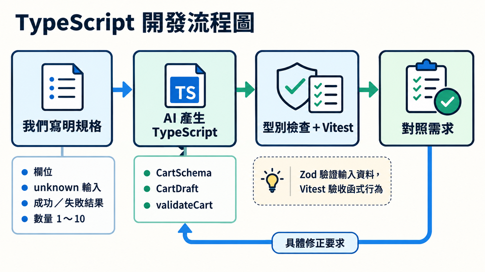

前一篇我們看了 AI 寫的程式，發現需求沒說清楚時，程式與測試可能一起偏離預期。這次先把資料結構、函式用法與驗收條件寫出來，再請 AI 實作。

這裡的 AI 是協助我們寫 TypeScript 的開發工具。想讓它產生符合需求的程式，可以把前面學過的型別與 Zod 規則，寫進工作說明裡。

## 把想要的結構寫進 Prompt

功能描述說明使用者要做什麼；資料契約則寫出欄位、函式輸入與回傳結果。提供這些要求後，拿到程式就能逐項對照，也更容易指出需要修改的地方。

```text
請用 TypeScript 與 Zod 實作 Pizza 購物車輸入驗證。

三個欄位都必填：pizzaId 是字串，quantity 是整數，note 是字串。
匯出 CartSchema，用 z.infer 取得 CartDraft，型別與規則共用一份定義。

建立 validateCart(raw: unknown)：
先用 Schema 驗證，再去除字串前後空白。
餐點編號不能空白，數量必須介於 1～10。
成功回傳 { ok: true, cart }；失敗回傳 { ok: false, errors: string[] }。

基本欄位放在 Schema，文字整理與使用規則放在驗證函式。
請先完成資料模組，再接表單，保留以上匯出名稱與回傳結構。
```

這份 Prompt 同時說明可接受的資料與函式契約。數量範圍、空白處理與失敗結果都已寫明，AI 的實作與測試就有可對照的依據。

## 看生成的程式有沒有照規格寫

先看 AI 產生的資料定義。下面的註解標出它如何對應前面提出的要求：

```ts
// cart-schema.ts
import * as z from "zod";

export const CartSchema = z.object({
  pizzaId: z.string(),
  quantity: z.number().int(),
  note: z.string(),
});
// Prompt 要求型別與規則共用一份定義：從 CartSchema 取得型別
export type CartDraft = z.infer<typeof CartSchema>;

// Prompt 指定兩種回傳結果
export type ValidationResult =
  | { ok: true; cart: CartDraft }       // 成功：帶回可使用的購物車資料
  | { ok: false; errors: string[] };   // 失敗：帶回錯誤提示
```

這些宣告描述回傳格式，實際行為則用 Vitest 檢查：把輸入交給 `validateCart`，再比對回傳結果是否符合需求。

## 請 AI 把驗收條件寫成測試

可以接著把要接受與拒絕的資料，以及預期結果交給 AI：

```text
請用 Vitest 檢查 validateCart。

有效資料與數量 1、10 要接受；0、11、小數、字串數量要拒絕。
缺少任一必要欄位、欄位型別錯誤或餐點編號只有空白，都要拒絕。
成功結果要保留數量，去除 pizzaId 與 note 的前後空白。
失敗結果要提供非空的 errors，且不能帶有成功的 cart。

依照以上需求決定預期結果，執行測試與型別檢查，回報實際結果。
若環境無法執行，請列出未完成的檢查。
```

下面是其中兩個測試的參考寫法，用來檢查文字整理與無效數量：

```ts
// validate-cart.test.ts
import { expect, test } from "vitest";
import { validateCart } from "./validate-cart";

test("有效資料會整理文字空白", () => {
  const result = validateCart({
    pizzaId: " margherita ", quantity: 2, note: " 不要辣 ",
  });
  // 比對完整成功結果，包含整理後的文字
  expect(result).toEqual({
    ok: true,
    cart: { pizzaId: "margherita", quantity: 2, note: "不要辣" },
  });
});

test("數量 0 會回傳失敗與提示", () => {
  const result = validateCart({ pizzaId: "margherita", quantity: 0, note: "" });
  expect(result.ok).toBe(false);
  expect(result).not.toHaveProperty("cart");
  if (!result.ok) expect(result.errors.length).toBeGreaterThan(0);
});
```

`expect` 用來檢查結果是不是我們要的。

拿到 AI 寫的測試後，再看看前面列出的要求有沒有測到，例如數量 1、10，以及缺少欄位或型別錯誤的資料。如果測試失敗，就把測試資料、程式回傳的結果與我們想要的結果一起交給 AI，請它修改後再跑一次。



## 用具體結果請 AI 修正

發現落差時，把收到的輸入、目前結果與預期結果一起提供，更容易確認修改方向。例如，資料模組把字串數量自動轉成數字，可以這樣補充：

```text
quantity 要接收 number；字串 "2" 應驗證失敗。
請保留 CartDraft 與 ValidationResult 的契約，修正輸入處理，
補上字串數量的回歸案例，再跑型別檢查與測試。
表單使用 valueAsNumber 取得數字，資料模組不自動轉換字串。
```

修改後，核對原有欄位與回傳格式是否保留，再檢查相關測試結果。請 AI 提供實際執行的檢查與失敗項目，也方便分清楚「程式已修改」與「驗收已完成」。

> [!TIP] 可操作範例 / Demo project
> [Pizza 範例的 day-28 分支](https://github.com/johnsonchen3669/type-demo-2026/tree/day-28)提供表單驗證、測試與開發 Prompt。Day 28 沿用 Day 27 的表單，新增內容主要是開發 Prompt 與驗收測試。Demo 的「本日重點」提供開發說明入口；安裝與操作方式放在 README。

## 今日練習

[day28 | 型旅 TypeTrail](https://typetrail.johnsonchen.dev/#/day/28)

## 結論

請 AI 寫 TypeScript 時，可以先寫明資料與函式契約，再用型別檢查、Zod 與測試確認實作。發現落差後，用具體輸入與預期結果提出修正要求。

資料規則確定後，新增功能就能沿用這些型別與驗證方式，讓功能逐步增加時仍有一致的用法。
