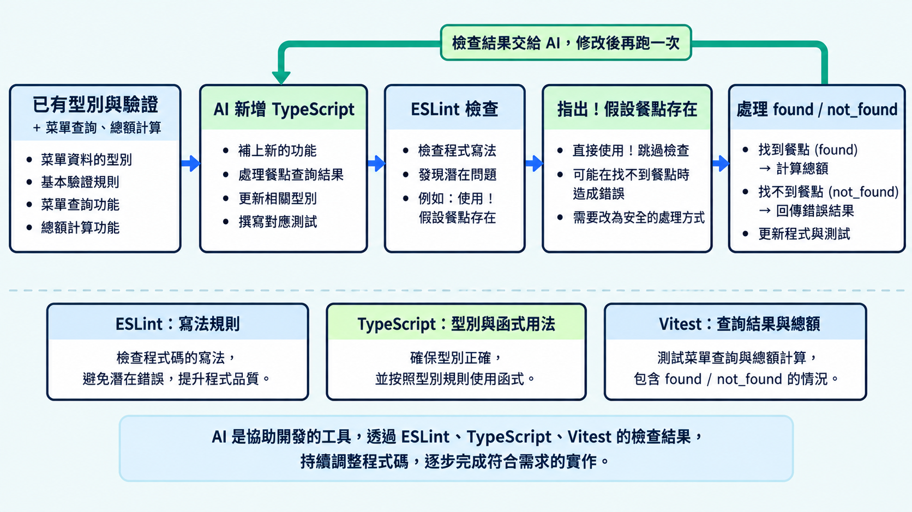

實務上，團隊通常會在專案中設定一套程式檢查規則，確保大家遵守相同的寫法要求，例如避免隨意使用 `any`，或直接假設資料一定存在。請 AI 寫程式時，也要讓它遵守這套規則；不符合規則的寫法會在檢查時報錯，指出需要修改的位置。

今天增加菜單查詢與總額計算，再用 ESLint 檢查新程式。

> [!TIP] 程式檢查工具 / ESLint
> ESLint 會依照專案設定的規則檢查程式，指出不符合規則的寫法與所在位置。規則可以由團隊選擇，讓大家與 AI 寫的程式遵守相同要求。

## 請 AI 沿用原本的程式加功能

把相關程式與測試一起交給 AI，說明哪些型別與規則要保留。這次繼續使用 `CartDraft`，先驗證輸入，再把通過的資料交給新函式。

```text
請在現有 Pizza 購物車中，加入菜單查詢與購物車摘要。

菜單有：
- 瑪格麗特：margherita，280 元
- 蘑菇起司：mushroom，320 元
- 辣味臘腸：pepperoni，360 元

先驗證輸入，再查詢餐點。找到後，整理餐點名稱、數量、備註與總額；
找不到時，要回傳明確的結果，讓畫面能顯示提示。
總額使用菜單價格乘以數量。

沿用現有型別與驗證規則，修改查詢結果時不要影響原菜單。
遵守專案的 ESLint 規則，補上新功能的測試，並確認原本的測試仍通過。
```

## 為什麼有型別檢查，還要加 lint 規則？

有些寫法能通過 TypeScript 檢查，團隊卻不希望使用。例如 `!`（非空斷言）會告訴 TypeScript「這個值一定存在」，但不會實際檢查資料。

```ts
// 假設 AI 或團隊成員手寫查詢函式時，使用了這種寫法
// menu 是 Pizza[]，find 找不到餐點時會回傳 undefined
function findPizza(pizzaId: string): MenuResult {
  const pizza = menu.find((item) => item.id === pizzaId)!;
  // 加上 ! 後，TypeScript 把 pizza 當成一定存在的餐點
  // 即使找不到，這裡仍會回傳 found，卻沒有真正的餐點資料
  return { status: "found", pizza };
}
```

TypeScript 會接受這個斷言，因此型別檢查可以通過。若團隊要求「遇到可能缺值的資料，要先判斷，不能直接加 `!`」，就可以用 ESLint 的 `no-non-null-assertion` 規則檢查。AI 或團隊成員使用這種寫法時，lint 便會報錯，要求修改。

在 ESLint 設定的 `rules` 中加入這項規則，設為 `"error"`，違反時就會報錯：

```js
// eslint.config.mjs：只保留這項規則需要的設定
import tseslint from "typescript-eslint";

export default [{
  files: ["**/*.ts"],
  languageOptions: { parser: tseslint.parser },
  plugins: { "@typescript-eslint": tseslint.plugin },
  rules: {
    "@typescript-eslint/no-non-null-assertion": "error",
  },
}];
```

`parser` 與 `plugins` 讓 ESLint 能讀取 TypeScript、使用對應規則。其他設定放在 Demo，這裡先看規則名稱與 `"error"` 的作用。

## 用 ESLint 指出需要檢查的寫法

`typescript-eslint` 提供 TypeScript 的解析與檢查規則。Demo 選用兩項：

| 規則 | 本專案的要求 |
|---|---|
| `no-explicit-any` | 不直接宣告 `any`，讓資料繼續受到型別檢查 |
| `no-non-null-assertion` | 不用 `!` 假設值存在，改成處理可能缺值的情況 |

這些是這次 Demo 採用的寫法要求。前面的查詢會被第二項規則指出，提醒我們回頭處理找不到餐點的情況。

```sh
# 在 Demo 專案執行，設定與安裝方式放在 README
npm run lint
```

> [!TIP] TypeScript 程式檢查 / typescript-eslint
> `typescript-eslint` 讓 ESLint 能檢查 TypeScript，也提供需要型別資訊的進階規則。本篇先用兩項寫法規則；[官方規則文件](https://typescript-eslint.io/rules/)可以查各項規則的用途與適用情況。

## 把檢查結果交給 AI 修正

把 ESLint 指出的程式與原需求一起提供，請 AI 修正原因。不要只給它一句「讓 lint 通過」，否則修改方向仍然不清楚。

也要注意修改中有沒有加入 `eslint-disable-next-line`。這個註解會停用下一行的指定規則；加上它可以避開報錯，卻沒有處理原本的缺值問題。

```text
lint 檢查指出 findPizza 裡的 ! 不符合專案規則，請幫我修正。

找不到餐點時，應回傳 not_found；找到時，維持原本的回傳格式。
請保留 lint 規則，也加上找不到餐點的測試。

修改後，執行 lint、型別檢查與所有測試，告訴我有沒有通過。
```

AI 修改後，原本的 `!` 應該換成缺值判斷。例如下面先處理找不到餐點的情況，再回傳找到的資料：

```ts
// menu.ts，Pizza 是 { id: string; name: string; price: number }
export type MenuResult =
  | { status: "found"; pizza: Pizza }
  | { status: "not_found" };

export function findPizza(pizzaId: string): MenuResult {
  const pizza = menu.find((item) => item.id === pizzaId);
  // 先處理找不到的情況，就不需要用 ! 假設餐點存在
  if (!pizza) return { status: "not_found" };
  // 通過判斷後，pizza 就是找到的餐點
  // 複製餐點資料，使用端修改結果時不會改到原菜單
  return { status: "found", pizza: { ...pizza } };
}
```

## 看一下 AI 改了哪些地方

檢查通過後，也可以用 `git diff` 查看修改前後的差異。它會列出刪除與新增的內容，方便確認 AI 改了哪些地方，有沒有順便調整原本的規則或測試。

```sh
# 在專案中查看尚未暫存的修改
git diff
```

修改整理成 GitHub 的 PR 後，也可以搭配下面的工具，幫忙閱讀這次變更。

> [!TIP] 閱讀程式修改 / pulls.review
> 這裡推薦一下，知名開源社群開發者 Anthony Fu 的新作 [pulls.review](https://pulls.review/)。它會把 PR 的修改分組、整理摘要，這次檢查 AI 修改的程式時，也很適合搭配使用。[官方說明](https://github.com/antfu/pulls.review#readme)。



> [!TIP] 可操作範例 / Demo project
> [Pizza 範例的 day-29 分支](https://github.com/johnsonchen3669/type-demo-2026/tree/day-29)增加菜單查詢、摘要函式與 lint。畫面可以驗證輸入、查詢餐點，摘要先透過測試確認；安裝與操作方式放在 README，開發說明可由「本日重點」開啟。

## 今日練習

[day29 | 型旅 TypeTrail](https://typetrail.johnsonchen.dev/#/day/29)

## 結論

新增功能時，可以把容易忽略的寫法交給 ESLint 檢查，再依照需求修正。原本的型別、驗證與測試也要保留，幫我們確認功能增加後的結果。
