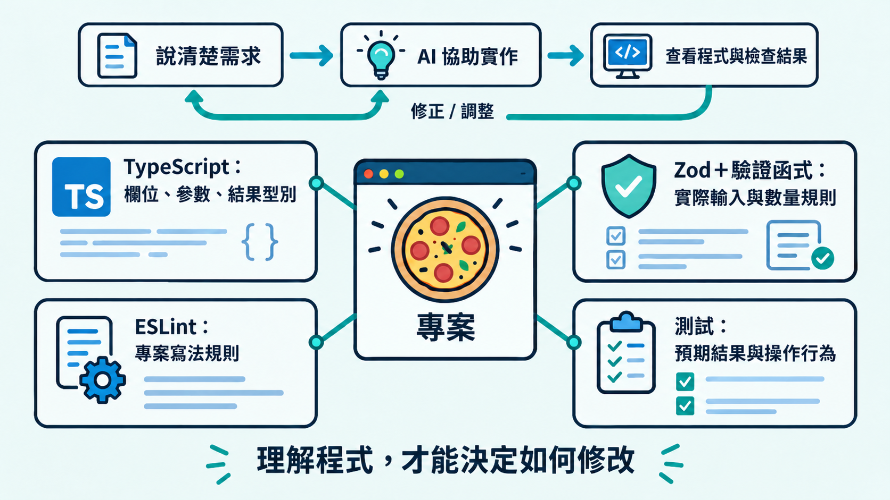

第一天問過：「AI 都會寫程式了，為什麼還要學 TypeScript？」寫到最後一天，來回顧一下這 30 天學到的內容，看看它們怎麼幫助我們讀懂和修改程式。

AI 可以幫忙寫功能，我們接手程式時，也需要看懂它怎麼處理資料、遇到錯誤時會怎麼做。學過 TypeScript 後，就比較知道哪些地方要檢查，也能把修改要求說得更清楚。

今天把前面的觀念串起來，也搭配範例專案，看看這些寫法怎麼用在程式中。

## 先知道 JavaScript 怎麼執行

TypeScript 可以看成加上型別檢查的 JavaScript。閉包如何保存變數、方法呼叫時的 `this`、非同步工作的順序，都會影響程式的結果。

型別檢查幫我們確認程式的用法，實際結果還要看程式怎麼執行。`as` 與 `!` 只改變 TypeScript 看待資料的方式，不會轉換資料或檢查值是否存在。使用前，要知道資料為什麼符合這個型別、為什麼一定有值。

## 把要求寫進型別，修改時才有依據

從物件、聯集到函式與泛型，我們逐步把欄位、可能的狀態，以及輸入與輸出的關係寫出來。這些宣告讓 TypeScript 能指出不符合要求的使用方式，例如把字串傳給數字參數，或在失敗結果中讀取成功資料。

成功與失敗的欄位分開後，使用端要先判斷，才能取得對應資料：

```ts
// 簡化的摘要結果，完整型別放在 Demo
type SummaryResult =
  | { status: "success"; summary: { total: number } }
  | { status: "not_found" };

function summaryMessage(result: SummaryResult): string {
  if (result.status === "success") {
    return `合計 NT$ ${result.summary.total}`;
  }
  return "找不到餐點";
}
```

改動欄位或函式時，型別檢查也能幫忙找出需要跟著調整的使用端。前提是相關程式受到檢查，且宣告確實表達了需求；隨意用 `any` 或斷言略過錯誤，就會少掉這些提醒。

## 型別、資料驗證與測試各有用途

處理外部資料時，`unknown` 可以表達「尚未確認」，讓程式先檢查，再使用欄位。把資料直接寫成 `as CartDraft`，會讓 TypeScript 採用這個型別，卻省去了確認實際內容的步驟。

在範例中，可以看出幾項檢查各自負責什麼：

| 檢查 | 這次專案中的用途 |
|---|---|
| TypeScript | 檢查欄位、函式參數與成功／失敗結果的使用 |
| Zod | 驗證實際輸入的欄位與型別；驗證函式接著檢查數量範圍 |
| ESLint | 依專案規則指出直接宣告的 `any` 與非空斷言 |
| 測試 | 對照指定輸入，確認驗證結果、價格計算與操作行為 |

TypeScript 把欄位、函式參數與回傳結果的要求串起來，讓不同模組使用資料時有共同依據。資料驗證與測試則確認實際輸入和處理結果，讓這些要求從程式宣告一路延伸到執行時的檢查。



## 在範例專案中回顧這些觀念

這份範例的畫面與功能都很簡單，但可以看到 TypeScript 怎麼定義資料、限制函式的輸入與回傳，以及透過狀態判斷取得對應欄位。搭配輸入驗證、菜單查詢與總額計算，也能觀察這些型別怎麼用在不同模組之間。

> [!TIP] 範例專案 / Demo project
> [Pizza 範例的 day-30 分支](https://github.com/johnsonchen3669/type-demo-2026/tree/day-30)保留完整程式與配套測試，安裝、執行方式放在 README。

閱讀這份專案時，可以沿著一筆資料看下去：輸入在哪裡被驗證？通過後交給哪個函式？找不到餐點時回傳什麼？畫面在哪裡判斷結果？這樣比較容易看出型別宣告與實際程式如何配合。

## 接下來可以怎麼練習？

挑一個小需求修改，例如增加餐點，或調整允許的數量。先說清楚預期結果，再請 AI 修改，看看型別、驗證與測試中有哪些地方要一起調整。

遇到型別錯誤時，先看資料來源與使用方式。需要查語法就查文件，需要確認結果就執行程式；不要急著把它改成 `any`。也可以請 AI 解釋錯誤原因，再對照實際程式確認。

在 AI 時代，不用把每一種語法都背起來，具體寫法可以查文件或請 AI 協助。更值得練習的是看懂程式，知道問題出在哪裡、預期結果應該是什麼，才能請 AI 改對地方，也能確認它真的修好了。

## 今日練習

[day30 | 型旅 TypeTrail](https://typetrail.johnsonchen.dev/#/day/30)

## 結論

回到第一天的問題，學 TypeScript 的價值，是讓我們更有依據地閱讀、修改與確認程式。AI 可以協助實作，型別可以把部分要求變成檢查；需求是否完整、資料從哪裡來，以及結果是否合用，則需要我們理解後做出判斷。

這 30 天先建立了這些基礎。之後換成別的框架、套件或 AI 工具，也可以先看清楚專案的資料怎麼設計、從哪裡進來，再沿著程式看它如何被驗證、傳遞與使用。
